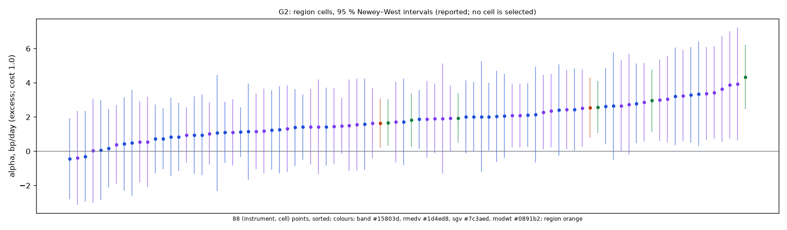
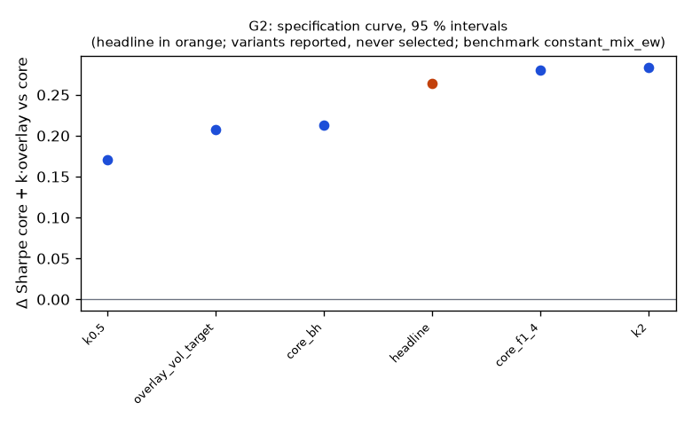

# Family G2

**Mechanism.** A zero-beta, long-volatility intraday overlay (G1: trend continuation after a move beyond the day's noise band, flat overnight) earns most when a long-only core loses (2018, 2020, 2022); adding it to a volatility-managed index core (Moreira & Muir 2017) at equal notional raises the portfolio's Sharpe ratio and does not deepen its drawdown, which leverage alone would not do.

- Registered: e66c3143ce0532885cdc0d3da92b6b2dbd93b0df (2026-10-11); run at 2026-10-11T05:56:13.467301+00:00, code f840e0158da5, git 1a95e8b01f55
- Instruments: QQQ, SPY (pooled, weights QQQ 0.50, SPY 0.50, equal weights); window 2016-01-04 → 2025-10-01; benchmark constant_mix_ew
- N_eff 1.06 of 2 instruments (the pooled stream's effective count)
- Test: marginal, one-sided, at cost 1.0; excess returns: FRED DTB3 as of each session's open, ACT/360
- MDE line: Δ Sharpe 0.53 at 80% power over 2400 days, ρ 0.860, reference Sharpe 0.70, 4 families; expected 0.45 → a DIAGNOSTIC (below its MDE)
- MDE at the realized ρ 0.895 and reference Sharpe 1.06 over 2400 days: Δ Sharpe 0.46 (reported; the registered line is the one above)
- Trials: family 6 / budget 6; program 17 / 42 trials, 2 / 5 families

## Headline test

- Sharpe(core + 1.00 × overlay) 1.33 vs core 1.06 on 2400 days: difference 0.26 (interval 0.02 … —), Ledoit–Wolf one-sided p = 0.0398; max drawdown -20.5 % vs -19.4 % (difference -1.0 %, interval -7.5 % … 11.0 %)
- Matched volatility: the core levered ×1.10 to the portfolio's 14.8 % earns 15.7 %/yr (max DD -21.2 %) vs the portfolio's 20.3 %/yr (-20.5 %); overlay–core correlation -0.032
- Looks: K = 158 configurations examined on the development window (families/looks.jsonl); Bonferroni bound p × K = 1.0000
- PSR(0) 0.995; DSR 0.472 (N = 61 program trials, V = 0.000959) — a ledger diagnostic, not part of the verdict
- Alpha 5.3 %/yr (NW t 2.74, p 0.0061), beta -0.00
- Floors: min_net_ret 0.052 vs 0.030 → ok; min_edge_to_cost 2.990 vs 2.000 → ok; max_dd_vs_core -0.205 vs -0.194 → FAIL
- Coherence (variants): 5 variants, share with the headline's sign 1.00, median variant core_bh (floors no) → NOT coherent
- Before Holm across families: p 0.0398, floors no, coherent no, positive yes (at cost 1.0)

## Cost curve (every variant re-priced from its cost ledger; the verdict reads one column)

| variant | registered | 0.3 | 1.0 | 2.3 |
|---|---|---|---|---|
| headline | 0.068 (p 0.327); SR 0.70, ret 4.5 %, floors no | 0.384 (p 0.006); SR 1.40, ret 9.4 %, floors no | 0.264 (p 0.040); SR 1.13, ret 7.5 %, floors no | 0.041 (p 0.397); SR 0.64, ret 4.1 %, floors no |
| k0.5 | 0.066 (p 0.200); SR 0.70, ret 4.5 %, floors no | 0.236 (p 0.002); SR 1.40, ret 9.4 %, floors yes | 0.171 (p 0.018); SR 1.13, ret 7.5 %, floors yes | 0.051 (p 0.254); SR 0.64, ret 4.1 %, floors no |
| k2 | -0.028 (p 0.544); SR 0.70, ret 4.5 %, floors no | 0.476 (p 0.031); SR 1.40, ret 9.4 %, floors no | 0.284 (p 0.132); SR 1.13, ret 7.5 %, floors no | -0.071 (p 0.609); SR 0.64, ret 4.1 %, floors no |
| core_bh | 0.076 (p 0.215); SR 0.70, ret 4.5 %, floors no | 0.297 (p 0.004); SR 1.40, ret 9.4 %, floors no | 0.213 (p 0.022); SR 1.13, ret 7.5 %, floors no | 0.057 (p 0.277); SR 0.64, ret 4.1 %, floors no |
| core_f1_4 | 0.077 (p 0.311); SR 0.70, ret 4.5 %, floors no | 0.406 (p 0.005); SR 1.40, ret 9.4 %, floors no | 0.280 (p 0.037); SR 1.13, ret 7.5 %, floors no | 0.048 (p 0.382); SR 0.64, ret 4.1 %, floors no |
| overlay_vol_target | 0.010 (p 0.453); SR 0.62, ret 2.8 %, floors no | 0.328 (p 0.002); SR 1.55, ret 7.4 %, floors yes | 0.208 (p 0.027); SR 1.20, ret 5.6 %, floors yes | -0.016 (p 0.554); SR 0.54, ret 2.5 %, floors no |

Columns: `registered` = the simulated costs (quotes half-spread + slippage per side); a number = that round-trip cost in bp on every fill; `measured` = the forward test's fill reconciliation. The headline column shows its statistic and p first.

## Account check (risk/account.py; nothing here changes a P&L)

- margin_30k (margin account, equity 30,000): tradable
- Day trades: 10549 in total, at most 44 in 5 sessions; PDT rule applies: no; first flag None
- Gross exposure: 1.00× intraday (limit 4×), 0.00× overnight (limit 2×); first breach None
- What the PDT rule would cost on an account under the floor: 0.0 % of the day trades blocked (0)

## Data notes

- Headline members: 92 session(s) priced with the first as-of cost table (2016Q1), 0 bar(s) in stress sessions, 0 session(s) without a cash-yield rate

## Core families (run in this batch; no trial, no Holm)

- G2_core: registered 4208d7bf2bc47097b5f91f320fe96cad69cfffe8 (2026-10-11); QQQ, SPY (weights QQQ 0.50, SPY 0.50); benchmark constant_mix_ew
  - headline: 2 member cell(s); raw Sharpe 1.23, return 16.8 %/yr, vol 13.4 %, max DD -18.5 % (booked costs, T-bill credited)
  - benchmark: 0 member cell(s); raw Sharpe 0.91, return 17.4 %/yr, vol 20.0 %, max DD -30.9 % (booked costs, T-bill credited)
- G2_core4: registered 4208d7bf2bc47097b5f91f320fe96cad69cfffe8 (2026-10-11); DIA, IWM, QQQ, SPY (weights DIA 0.29, IWM 0.20, QQQ 0.23, SPY 0.28); benchmark constant_mix_er
  - headline: 4 member cell(s); raw Sharpe 1.11, return 14.2 %/yr, vol 12.7 %, max DD -18.2 % (booked costs, T-bill credited)

**Core + k × overlay on the registered account** (PLAN3 G2: overlay notional + core notional ≤ 2 × equity at every decision; the account check applies Reg-T 2× overnight and 4× intraday at or above the PDT floor)

| variant | core | k | max gross intraday | max gross overnight | ≤ 2× (PLAN3) | account | reasons |
|---|---|---|---|---|---|---|---|
| headline | G2_core/headline | 1.00 | 2.00 | 1.00 | yes | tradable | — |
| k0.5 | G2_core/headline | 0.50 | 1.50 | 1.00 | yes | tradable | — |
| k2 | G2_core/headline | 2.00 | 3.00 | 1.00 | no | tradable | — |
| core_bh | G2_core/benchmark | 1.00 | 2.00 | 1.00 | yes | tradable | — |
| core_f1_4 | G2_core4/headline | 1.00 | 2.00 | 1.00 | yes | tradable | — |
| overlay_vol_target | G2_core/headline | 1.00 | 2.89 | 1.00 | no | tradable | — |

## Region cells (the specification curve over every cell; reported, the region is the headline)

*The cells are the region's ungated, unscaled positions (the gate and the vol target scale the region only); with a marginal or paired test they are the overlay's / reference's cells, and their alpha sign is not this family's statistic: reported for the parity check, never this family's coherence.*

- Parity of the re-simulation (wfo.position_backtest) with the headline members at the booked costs: QQQ max |Δ daily return| 0 over 2432 days; SPY max |Δ daily return| 0 over 2436 days

Region re-simulated at each cost: alpha bp/day (excess Sharpe). The headline test re-prices the members' cost ledgers instead (first order); the two agree to the re-pricing error.

| region | registered | 0.3 | 1.0 | 2.3 |
|---|---|---|---|---|
| QQQ | 1.35 bp (0.45) | 3.24 bp (1.09) | 2.54 bp (0.85) | 1.24 bp (0.41) |
| SPY | 0.58 bp (0.24) | 2.30 bp (0.97) | 1.64 bp (0.69) | 0.37 bp (0.15) |
| pooled | 0.96 bp (0.37) | 2.77 bp (1.06) | 2.09 bp (0.80) | 0.80 bp (0.31) |

- 86 (instrument, cell) points at cost 1.0: share with the headline's sign 0.965, median cell 1.77 bp/day; positive 83 / 86
- By estimator: band 6/6 positive, median 2.26 bp; rmedv 38/40 positive, median 1.42 bp; sgv 39/40 positive, median 1.89 bp



Every cell at cost 1.0, alpha bp/day (excess), sorted by the pooled cell:

| cell | QQQ | SPY | pooled | CI (pooled) | Sharpe (pooled) |
|---|---|---|---|---|---|
| sgv_n12_t1 | 3.89 | 3.24 | 3.56 | 0.86 … 6.26 | 0.88 |
| sgv_n12_t0.75 | 3.93 | 3.06 | 3.49 | 0.81 … 6.18 | 0.83 |
| sgv_n12_t1.5 | 3.36 | 2.87 | 3.11 | 0.83 … 5.39 | 0.86 |
| band_vm1 | 4.34 | 1.81 | 3.07 | 1.53 … 4.61 | 1.12 |
| sgv_n6_t1.5 | 3.44 | 1.87 | 2.65 | 0.51 … 4.79 | 0.71 |
| rmedv_n12_t1.5 | 3.30 | 2.00 | 2.65 | 0.38 … 4.91 | 0.74 |
| sgv_n9_t1 | 2.74 | 2.29 | 2.51 | 0.22 … 4.80 | 0.64 |
| band_vm1.25 | 2.96 | 1.94 | 2.45 | 0.96 … 3.93 | 0.98 |
| sgv_n18_t1.5 | 2.99 | 1.91 | 2.45 | 0.41 … 4.48 | 0.68 |
| rmedv_n24_t1.5 | 2.63 | 2.12 | 2.37 | 0.45 … 4.29 | 0.81 |
| sgv_n24_t1.5 | 2.43 | 2.09 | 2.26 | 0.33 … 4.18 | 0.76 |
| rmedv_n6_t1.5 | 3.22 | 1.24 | 2.23 | -0.05 … 4.50 | 0.59 |
| rmedv_n9_t1.5 | 2.41 | 2.01 | 2.21 | 0.09 … 4.33 | 0.61 |
| band_vm1.5 | 2.58 | 1.67 | 2.12 | 0.84 … 3.40 | 0.99 |
| rmedv_n18_t0.75 | 2.14 | 2.07 | 2.10 | -0.32 … 4.53 | 0.52 |
| sgv_n6_t1 | 3.63 | 0.56 | 2.09 | -0.44 … 4.62 | 0.48 |
| rmedv_n18_t1.5 | 2.79 | 1.09 | 1.94 | 0.07 … 3.81 | 0.59 |
| rmedv_n6_t1 | 3.35 | 0.44 | 1.89 | -0.63 … 4.41 | 0.44 |
| sgv_n9_t1.5 | 1.18 | 2.36 | 1.77 | -0.29 … 3.83 | 0.50 |
| sgv_n12_t2 | 2.51 | 1.04 | 1.77 | -0.08 … 3.63 | 0.56 |
| rmedv_n9_t2 | 1.39 | 2.02 | 1.70 | -0.21 … 3.61 | 0.56 |
| rmedv_n12_t2 | 2.44 | 0.85 | 1.64 | -0.36 … 3.64 | 0.52 |
| sgv_n6_t2 | 1.31 | 1.94 | 1.62 | -0.41 … 3.66 | 0.50 |
| sgv_n24_t0.75 | 2.65 | 0.55 | 1.60 | -0.74 … 3.93 | 0.41 |
| rmedv_n12_t1 | 2.02 | 1.15 | 1.58 | -1.19 … 4.36 | 0.38 |
| sgv_n18_t0.75 | 1.43 | 1.71 | 1.56 | -0.77 … 3.90 | 0.38 |
| sgv_n18_t2 | 1.63 | 1.49 | 1.56 | -0.15 … 3.26 | 0.55 |
| rmedv_n24_t0.75 | 1.60 | 1.44 | 1.51 | -0.75 … 3.78 | 0.39 |
| sgv_n24_t2 | 2.09 | 0.93 | 1.51 | -0.09 … 3.11 | 0.60 |
| sgv_n18_t1 | 1.55 | 1.46 | 1.51 | -0.76 … 3.77 | 0.38 |
| rmedv_n24_t2 | 1.87 | 1.12 | 1.49 | 0.01 … 2.98 | 0.63 |
| rmedv_n18_t1 | 2.04 | 0.94 | 1.49 | -0.74 … 3.71 | 0.38 |
| rmedv_n12_t0.75 | 1.07 | 1.72 | 1.39 | -1.31 … 4.09 | 0.34 |
| sgv_n24_t1 | 1.51 | 1.16 | 1.33 | -0.94 … 3.61 | 0.36 |
| sgv_n9_t2 | 1.42 | 1.11 | 1.26 | -0.64 … 3.16 | 0.41 |
| rmedv_n6_t0.75 | 2.64 | -0.30 | 1.17 | -1.29 … 3.63 | 0.26 |
| rmedv_n18_t2 | 1.41 | 0.74 | 1.07 | -0.59 … 2.73 | 0.41 |
| rmedv_n24_t1 | 1.25 | 0.83 | 1.04 | -1.15 … 3.23 | 0.29 |
| rmedv_n6_t2 | 0.95 | 0.72 | 0.83 | -1.02 … 2.69 | 0.26 |
| sgv_n6_t0.75 | 1.91 | -0.39 | 0.76 | -1.86 … 3.38 | 0.16 |
| sgv_n9_t0.75 | 0.03 | 0.39 | 0.21 | -2.22 … 2.64 | 0.05 |
| rmedv_n9_t1 | 0.06 | 0.18 | 0.12 | -2.23 … 2.47 | 0.03 |
| rmedv_n9_t0.75 | 0.48 | -0.44 | 0.02 | -2.46 … 2.51 | 0.01 |

*each cell re-simulated by wfo.position_backtest on the member's inputs; `measured` prices decision fills at the profile's `open` class and the closing fill at `close_auction` (`close` under FILL_AUCTION last_bar)*

## Trade statistics (headline; booked costs)

| instrument | round_trips_per_day | sessions_traded | long_pnl_bp_per_day | short_pnl_bp_per_day | long / short trades |
|---|---|---|---|---|---|
| QQQ | 1.002 | 0.995 | 1.041 | 0.449 | 15049 / 12497 |
| SPY | 0.977 | 0.992 | 0.562 | 0.000 | 14755 / 12195 |
| pooled | 0.989 | 0.994 | 0.802 | 0.224 |  |

Round trips per day: traded notional / the session's starting equity / 2, averaged over sessions. Long / short: trading P&L by side (booked costs) per day of the member's starting cash.

## Per-instrument headline alpha (cost 1.0; excess of the T-bill)

| instrument | days | alpha_bp | CI (NW 95 %) | sharpe |
|---|---|---|---|---|
| QQQ | 2432 | 2.54 | 0.82 … 4.26 | 0.85 |
| SPY | 2436 | 1.64 | 0.22 … 3.05 | 0.69 |

## Specification curve (reported; no variant is selected)



| variant | status | start | days | sharpe | statistic | CI | p | Δ on headline days | net ret | max dd | floors |
|---|---|---|---|---|---|---|---|---|---|---|---|
| headline | ok | 2016-01-25 | 2400 | 0.80 | 0.26 | 0.02 … — | 0.0398 | — | 7.5 % | -9.7 % | no |
| k0.5 | ok | 2016-01-25 | 2400 | 0.80 | 0.17 | 0.04 … — | 0.0178 | 0.17 | 7.5 % | -9.7 % | yes |
| k2 | ok | 2016-01-25 | 2400 | 0.80 | 0.28 | -0.13 … — | 0.1320 | 0.28 | 7.5 % | -9.7 % | no |
| core_bh | ok | 2016-01-25 | 2436 | 0.80 | 0.21 | 0.04 … — | 0.0222 | 0.21 | 7.5 % | -9.7 % | no |
| core_f1_4 | ok | 2016-01-25 | 2400 | 0.80 | 0.28 | 0.03 … — | 0.0368 | 0.28 | 7.5 % | -9.7 % | no |
| overlay_vol_target | ok | 2016-02-03 | 2400 | 0.73 | 0.21 | 0.03 … — | 0.0268 | 0.21 | 5.6 % | -5.4 % | yes |

`statistic` is the headline test's (Δ Sharpe vs the benchmark, the alpha, or the Δ Sharpe vs the core / reference). Coherence reads each variant's statistic on the days it shares with the headline (column 'Δ on headline days'); the curve and the p-values are each variant's own sample.

## Responses

| variant | crisis_return | max_dd | ret_ann | sharpe | skew | vol_ann | worst_day |
|---|---|---|---|---|---|---|---|
| headline | 2020-02-19..2020-03-24: -4.9 %; 2022-01-03..2022-10-13: 19.5 % | -0.097 | 0.052 | 0.802 | 1.845 | 0.066 | -0.026 |
| k0.5 | 2020-02-19..2020-03-24: -4.9 %; 2022-01-03..2022-10-13: 19.5 % | -0.097 | 0.052 | 0.802 | 1.845 | 0.066 | -0.026 |
| k2 | 2020-02-19..2020-03-24: -4.9 %; 2022-01-03..2022-10-13: 19.5 % | -0.097 | 0.052 | 0.802 | 1.845 | 0.066 | -0.026 |
| core_bh | 2020-02-19..2020-03-24: -4.9 %; 2022-01-03..2022-10-13: 19.5 % | -0.097 | 0.052 | 0.802 | 1.845 | 0.066 | -0.026 |
| core_f1_4 | 2020-02-19..2020-03-24: -4.9 %; 2022-01-03..2022-10-13: 19.5 % | -0.097 | 0.052 | 0.802 | 1.845 | 0.066 | -0.026 |
| overlay_vol_target | 2020-02-19..2020-03-24: 1.3 %; 2022-01-03..2022-10-13: 11.0 % | -0.063 | 0.033 | 0.728 | 1.462 | 0.047 | -0.021 |

Responses, splits and slices below: excess of the T-bill, at cost 1.0; mean_per_trade_bp and hit_rate are per position (a chain of rolled legs, ended at a side flip: Σ cash pnl / its largest leg notional) from the booked-cost trades.

## State splits (headline; reported with 95 % Newey–West intervals, not tested)

## Quasi-holdout slice (reported; never a gate)

*quasi-holdout 2025-10-01 → 2026-09-30: contaminated (the U11 holdout exposed these days' buy-and-hold outcomes before the families were chosen); a robustness slice, never a gate*

| slice | n_days | sharpe | bench_sharpe | ret | max_dd | mean_bp |
|---|---|---|---|---|---|---|
| 2025-10 → 2026-09 | 250 | -0.61 | 1.18 | -3.4 % | -5.3 % | -1.34 |

## Per-instrument headline Sharpe (raw and James–Stein shrunk toward the family mean)

| instrument | sharpe | sharpe_js |
|---|---|---|
| QQQ | 0.85 | 0.85 |
| SPY | 0.69 | 0.69 |

## Registered vs run spec

```
+registered: {sha: 'e66c3143ce0532885cdc0d3da92b6b2dbd93b0df', date: '2026-10-11'}
```
