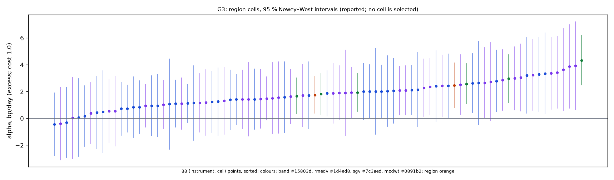
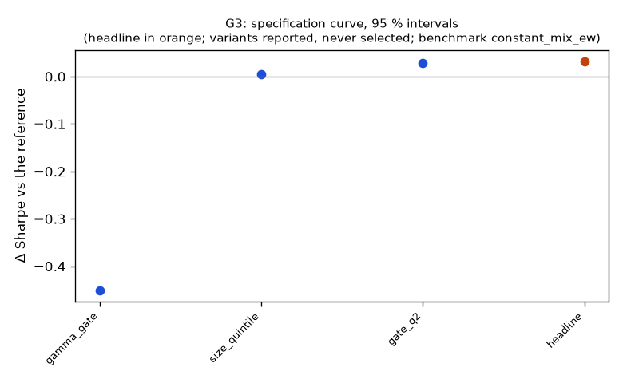

# Family G3

**Mechanism.** Hedging flows and order imbalances scale with volatility; in calm sessions the noise band is narrow and the continuation G1 trades is below its cost. Realized volatility is persistent (parameter rank is not: the RMV repo), so a state filter known at the open — skip the sessions after the calmest fifth of the past year — can raise G1's Sharpe ratio while giving up little of its return.

- Registered: e66c3143ce0532885cdc0d3da92b6b2dbd93b0df (2026-10-11); run at 2026-10-11T05:57:05.473075+00:00, code f840e0158da5, git 1a95e8b01f55
- Instruments: QQQ, SPY (pooled, weights QQQ 0.50, SPY 0.50, equal weights); window 2016-01-04 → 2025-10-01; benchmark constant_mix_ew
- N_eff 1.06 of 2 instruments (the pooled stream's effective count)
- Test: paired, one-sided, at cost 1.0; excess returns: FRED DTB3 as of each session's open, ACT/360
- MDE line: Δ Sharpe 0.28 at 80% power over 2400 days, ρ 0.962, reference Sharpe 0.95, 4 families; expected 0.20 → a DIAGNOSTIC (below its MDE)
- MDE at the realized ρ 0.975 and reference Sharpe 0.80 over 2436 days: Δ Sharpe 0.22 (reported; the registered line is the one above)
- Trials: family 4 / budget 6; program 21 / 42 trials, 3 / 5 families

## Headline test

- Sharpe 0.83 vs the reference's 0.80 on 2436 days (excess returns, both at cost 1.0): difference 0.032 (interval -0.080 … —), Ledoit–Wolf one-sided p = 0.3099; net return 5.2 %/yr vs 5.2 % (ratio 1.012); max DD -9.7 % vs -9.7 %; the streams differ on 630 days, correlation 0.975; first day 2016-01-25 (reference 2016-01-25)
- Looks: K = 158 configurations examined on the development window (families/looks.jsonl); Bonferroni bound p × K = 1.0000
- PSR(0) 0.997; DSR 0.512 (N = 65 program trials, V = 0.000959) — a ledger diagnostic, not part of the verdict
- Alpha 5.3 %/yr (NW t 2.82, p 0.0048), beta -0.00
- Floors: min_net_ret 0.052 vs 0.020 → ok; min_edge_to_cost 3.475 vs 2.000 → ok; min_net_ret_vs_reference 0.052 vs 0.047 → ok
- Coherence (variants): 3 variants, share with the headline's sign 0.67, median variant size_quintile (floors no) → NOT coherent
- Before Holm across families: p 0.3099, floors yes, coherent no, positive yes (at cost 1.0)

## Cost curve (every variant re-priced from its cost ledger; the verdict reads one column)

| variant | registered | 0.3 | 1.0 | 2.3 |
|---|---|---|---|---|
| headline | 0.095 (p 0.081); SR 0.81, ret 5.1 %, floors no | -0.009 (p 0.550); SR 1.40, ret 9.1 %, floors yes | 0.032 (p 0.310); SR 1.18, ret 7.6 %, floors yes | 0.108 (p 0.055); SR 0.76, ret 4.7 %, floors no |
| gate_q2 | 0.144 (p 0.107); SR 0.87, ret 5.2 %, floors no | -0.048 (p 0.669); SR 1.38, ret 8.5 %, floors no | 0.028 (p 0.406); SR 1.19, ret 7.3 %, floors yes | 0.168 (p 0.079); SR 0.84, ret 5.0 %, floors no |
| size_quintile | 0.102 (p 0.114); SR 0.85, ret 4.8 %, floors no | -0.059 (p 0.767); SR 1.39, ret 8.1 %, floors no | 0.005 (p 0.483); SR 1.19, ret 6.9 %, floors no | 0.123 (p 0.074); SR 0.81, ret 4.6 %, floors no |
| gamma_gate | -0.279 (p 0.870); SR 0.59, ret 2.5 %, floors no | -0.556 (p 0.989); SR 1.02, ret 4.4 %, floors no | -0.450 (p 0.968); SR 0.86, ret 3.7 %, floors no | -0.253 (p 0.846); SR 0.56, ret 2.4 %, floors no |

Columns: `registered` = the simulated costs (quotes half-spread + slippage per side); a number = that round-trip cost in bp on every fill; `measured` = the forward test's fill reconciliation. The headline column shows its statistic and p first.

## Account check (risk/account.py; nothing here changes a P&L)

- margin_30k (margin account, equity 30,000): tradable
- Day trades: 8439 in total, at most 44 in 5 sessions; PDT rule applies: no; first flag None
- Gross exposure: 1.00× intraday (limit 4×), 0.00× overnight (limit 2×); first breach None
- What the PDT rule would cost on an account under the floor: 0.0 % of the day trades blocked (0)

## Data notes

- Headline members: 92 session(s) priced with the first as-of cost table (2016Q1), 0 bar(s) in stress sessions, 0 session(s) without a cash-yield rate

## Reference families (run in this batch; no trial, no Holm)

- G1: registered c1689612eef33fd87f87ec99bc793cd3038bbc7b (2026-10-11); QQQ, SPY (weights QQQ 0.50, SPY 0.50); benchmark constant_mix_ew
  - headline: 2 member cell(s); raw Sharpe 0.70, return 4.5 %/yr, vol 6.6 %, max DD -10.1 % (booked costs, T-bill credited)

## Region cells (the specification curve over every cell; reported, the region is the headline)

*The cells are the region's ungated, unscaled positions (the gate and the vol target scale the region only); with a marginal or paired test they are the overlay's / reference's cells, and their alpha sign is not this family's statistic: reported for the parity check, never this family's coherence.*

- Parity of the re-simulation (wfo.position_backtest) with the headline members at the booked costs: QQQ max |Δ daily return| 0 over 2432 days; SPY max |Δ daily return| 0 over 2436 days

Region re-simulated at each cost: alpha bp/day (excess Sharpe). The headline test re-prices the members' cost ledgers instead (first order); the two agree to the re-pricing error.

| region | registered | 0.3 | 1.0 | 2.3 |
|---|---|---|---|---|
| QQQ | 1.48 bp (0.51) | 3.05 bp (1.05) | 2.47 bp (0.85) | 1.40 bp (0.48) |
| SPY | 0.88 bp (0.38) | 2.29 bp (0.99) | 1.75 bp (0.76) | 0.71 bp (0.31) |
| pooled | 1.18 bp (0.46) | 2.67 bp (1.05) | 2.11 bp (0.83) | 1.05 bp (0.42) |

- 86 (instrument, cell) points at cost 1.0: share with the headline's sign 0.965, median cell 1.77 bp/day; positive 83 / 86
- By estimator: band 6/6 positive, median 2.26 bp; rmedv 38/40 positive, median 1.42 bp; sgv 39/40 positive, median 1.89 bp



Every cell at cost 1.0, alpha bp/day (excess), sorted by the pooled cell:

| cell | QQQ | SPY | pooled | CI (pooled) | Sharpe (pooled) |
|---|---|---|---|---|---|
| sgv_n12_t1 | 3.89 | 3.24 | 3.56 | 0.86 … 6.26 | 0.88 |
| sgv_n12_t0.75 | 3.93 | 3.06 | 3.49 | 0.81 … 6.18 | 0.83 |
| sgv_n12_t1.5 | 3.36 | 2.87 | 3.11 | 0.83 … 5.39 | 0.86 |
| band_vm1 | 4.34 | 1.81 | 3.07 | 1.53 … 4.61 | 1.12 |
| sgv_n6_t1.5 | 3.44 | 1.87 | 2.65 | 0.51 … 4.79 | 0.71 |
| rmedv_n12_t1.5 | 3.30 | 2.00 | 2.65 | 0.38 … 4.91 | 0.74 |
| sgv_n9_t1 | 2.74 | 2.29 | 2.51 | 0.22 … 4.80 | 0.64 |
| band_vm1.25 | 2.96 | 1.94 | 2.45 | 0.96 … 3.93 | 0.98 |
| sgv_n18_t1.5 | 2.99 | 1.91 | 2.45 | 0.41 … 4.48 | 0.68 |
| rmedv_n24_t1.5 | 2.63 | 2.12 | 2.37 | 0.45 … 4.29 | 0.81 |
| sgv_n24_t1.5 | 2.43 | 2.09 | 2.26 | 0.33 … 4.18 | 0.76 |
| rmedv_n6_t1.5 | 3.22 | 1.24 | 2.23 | -0.05 … 4.50 | 0.59 |
| rmedv_n9_t1.5 | 2.41 | 2.01 | 2.21 | 0.09 … 4.33 | 0.61 |
| band_vm1.5 | 2.58 | 1.67 | 2.12 | 0.84 … 3.40 | 0.99 |
| rmedv_n18_t0.75 | 2.14 | 2.07 | 2.10 | -0.32 … 4.53 | 0.52 |
| sgv_n6_t1 | 3.63 | 0.56 | 2.09 | -0.44 … 4.62 | 0.48 |
| rmedv_n18_t1.5 | 2.79 | 1.09 | 1.94 | 0.07 … 3.81 | 0.59 |
| rmedv_n6_t1 | 3.35 | 0.44 | 1.89 | -0.63 … 4.41 | 0.44 |
| sgv_n9_t1.5 | 1.18 | 2.36 | 1.77 | -0.29 … 3.83 | 0.50 |
| sgv_n12_t2 | 2.51 | 1.04 | 1.77 | -0.08 … 3.63 | 0.56 |
| rmedv_n9_t2 | 1.39 | 2.02 | 1.70 | -0.21 … 3.61 | 0.56 |
| rmedv_n12_t2 | 2.44 | 0.85 | 1.64 | -0.36 … 3.64 | 0.52 |
| sgv_n6_t2 | 1.31 | 1.94 | 1.62 | -0.41 … 3.66 | 0.50 |
| sgv_n24_t0.75 | 2.65 | 0.55 | 1.60 | -0.74 … 3.93 | 0.41 |
| rmedv_n12_t1 | 2.02 | 1.15 | 1.58 | -1.19 … 4.36 | 0.38 |
| sgv_n18_t0.75 | 1.43 | 1.71 | 1.56 | -0.77 … 3.90 | 0.38 |
| sgv_n18_t2 | 1.63 | 1.49 | 1.56 | -0.15 … 3.26 | 0.55 |
| rmedv_n24_t0.75 | 1.60 | 1.44 | 1.51 | -0.75 … 3.78 | 0.39 |
| sgv_n24_t2 | 2.09 | 0.93 | 1.51 | -0.09 … 3.11 | 0.60 |
| sgv_n18_t1 | 1.55 | 1.46 | 1.51 | -0.76 … 3.77 | 0.38 |
| rmedv_n24_t2 | 1.87 | 1.12 | 1.49 | 0.01 … 2.98 | 0.63 |
| rmedv_n18_t1 | 2.04 | 0.94 | 1.49 | -0.74 … 3.71 | 0.38 |
| rmedv_n12_t0.75 | 1.07 | 1.72 | 1.39 | -1.31 … 4.09 | 0.34 |
| sgv_n24_t1 | 1.51 | 1.16 | 1.33 | -0.94 … 3.61 | 0.36 |
| sgv_n9_t2 | 1.42 | 1.11 | 1.26 | -0.64 … 3.16 | 0.41 |
| rmedv_n6_t0.75 | 2.64 | -0.30 | 1.17 | -1.29 … 3.63 | 0.26 |
| rmedv_n18_t2 | 1.41 | 0.74 | 1.07 | -0.59 … 2.73 | 0.41 |
| rmedv_n24_t1 | 1.25 | 0.83 | 1.04 | -1.15 … 3.23 | 0.29 |
| rmedv_n6_t2 | 0.95 | 0.72 | 0.83 | -1.02 … 2.69 | 0.26 |
| sgv_n6_t0.75 | 1.91 | -0.39 | 0.76 | -1.86 … 3.38 | 0.16 |
| sgv_n9_t0.75 | 0.03 | 0.39 | 0.21 | -2.22 … 2.64 | 0.05 |
| rmedv_n9_t1 | 0.06 | 0.18 | 0.12 | -2.23 … 2.47 | 0.03 |
| rmedv_n9_t0.75 | 0.48 | -0.44 | 0.02 | -2.46 … 2.51 | 0.01 |

*each cell re-simulated by wfo.position_backtest on the member's inputs; `measured` prices decision fills at the profile's `open` class and the closing fill at `close_auction` (`close` under FILL_AUCTION last_bar)*

## Trade statistics (headline; booked costs)

| instrument | round_trips_per_day | sessions_traded | long_pnl_bp_per_day | short_pnl_bp_per_day | long / short trades |
|---|---|---|---|---|---|
| QQQ | 0.824 | 0.786 | 1.100 | 0.608 | 12108 / 9715 |
| SPY | 0.799 | 0.773 | 0.681 | 0.264 | 11640 / 9470 |
| pooled | 0.812 | 0.779 | 0.891 | 0.436 |  |

Round trips per day: traded notional / the session's starting equity / 2, averaged over sessions. Long / short: trading P&L by side (booked costs) per day of the member's starting cash.

## Per-instrument headline alpha (cost 1.0; excess of the T-bill)

| instrument | days | alpha_bp | CI (NW 95 %) | sharpe |
|---|---|---|---|---|
| QQQ | 2432 | 2.47 | 0.78 … 4.15 | 0.85 |
| SPY | 2436 | 1.75 | 0.37 … 3.13 | 0.76 |

## Specification curve (reported; no variant is selected)



| variant | status | start | days | sharpe | statistic | CI | p | Δ on headline days | net ret | max dd | floors |
|---|---|---|---|---|---|---|---|---|---|---|---|
| headline | ok | 2016-01-25 | 2436 | 0.83 | 0.03 | -0.08 … — | 0.3099 | — | 7.6 % | -9.7 % | yes |
| gate_q2 | ok | 2016-01-25 | 2436 | 0.83 | 0.03 | -0.17 … — | 0.4061 | 0.03 | 7.3 % | -9.7 % | yes |
| size_quintile | ok | 2016-01-25 | 2436 | 0.81 | 0.01 | -0.13 … — | 0.4825 | 0.01 | 6.9 % | -9.7 % | no |
| gamma_gate | ok | 2016-01-25 | 2436 | 0.35 | -0.45 | -0.87 … — | 0.9676 | -0.45 | 3.7 % | -9.2 % | no |

`statistic` is the headline test's (Δ Sharpe vs the benchmark, the alpha, or the Δ Sharpe vs the core / reference). Coherence reads each variant's statistic on the days it shares with the headline (column 'Δ on headline days'); the curve and the p-values are each variant's own sample.

## Responses

| variant | crisis_return | exposure | max_dd | ret_ann | sharpe | skew | vol_ann | worst_day |
|---|---|---|---|---|---|---|---|---|
| headline | 2020-02-19..2020-03-24: -5.1 %; 2022-01-03..2022-10-13: 19.3 % | 0.824 | -0.097 | 0.052 | 0.834 | 1.984 | 0.064 | -0.026 |
| gate_q2 | 2020-02-19..2020-03-24: -5.1 %; 2022-01-03..2022-10-13: 19.4 % | 0.655 | -0.097 | 0.050 | 0.829 | 2.137 | 0.061 | -0.026 |
| size_quintile | 2020-02-19..2020-03-24: -5.1 %; 2022-01-03..2022-10-13: 18.4 % | 0.997 | -0.097 | 0.046 | 0.807 | 2.264 | 0.057 | -0.026 |
| gamma_gate | 2020-02-19..2020-03-24: -3.0 %; 2022-01-03..2022-10-13: 1.6 % | 0.495 | -0.105 | 0.014 | 0.352 | 3.547 | 0.043 | -0.022 |

Responses, splits and slices below: excess of the T-bill, at cost 1.0; mean_per_trade_bp and hit_rate are per position (a chain of rolled legs, ended at a side flip: Σ cash pnl / its largest leg notional) from the booked-cost trades.

## State splits (headline; reported with 95 % Newey–West intervals, not tested)

**vol_quintile**

| group | n_days | mean_bp | ci_bp | sharpe |
|---|---|---|---|---|
| n/a | 363 | -0.25 | -2.78 … 2.28 | -0.17 |
| q1 low | 497 | 0.24 | -1.36 … 1.84 | 0.19 |
| q2 | 362 | 0.27 | -2.33 … 2.87 | 0.15 |
| q3 | 365 | 1.21 | -1.79 … 4.21 | 0.63 |
| q4 | 404 | 4.30 | 0.22 … 8.38 | 1.65 |
| q5 high | 445 | 6.35 | 0.45 … 12.26 | 1.44 |

**year**

| group | n_days | mean_bp | ci_bp | sharpe |
|---|---|---|---|---|
| 2016 | 238 | -0.62 | -4.22 … 2.98 | -0.36 |
| 2017 | 251 | 0.41 | -1.46 … 2.27 | 0.39 |
| 2018 | 251 | 7.69 | 2.32 … 13.06 | 2.48 |
| 2019 | 252 | -0.43 | -2.24 … 1.38 | -0.37 |
| 2020 | 253 | 2.33 | -3.62 … 8.28 | 0.69 |
| 2021 | 252 | 1.62 | -1.15 … 4.39 | 0.92 |
| 2022 | 251 | 6.72 | -1.34 … 14.78 | 1.65 |
| 2023 | 250 | 0.44 | -1.99 … 2.87 | 0.27 |
| 2024 | 252 | 2.53 | -1.16 … 6.22 | 1.19 |
| 2025 | 186 | -0.41 | -7.04 … 6.23 | -0.12 |

## Sample splits (headline; reported)

| split | n_days | sharpe | bench_sharpe | ret | max_dd | mean_bp |
|---|---|---|---|---|---|---|
| 2016_2019 | 992 | 0.92 | 1.17 | 18.9 % | -4.1 % | 1.79 |
| 2020_2025 | 1444 | 0.81 | 0.72 | 37.8 % | -9.7 % | 2.32 |

## Quasi-holdout slice (reported; never a gate)

*quasi-holdout 2025-10-01 → 2026-09-30: contaminated (the U11 holdout exposed these days' buy-and-hold outcomes before the families were chosen); a robustness slice, never a gate*

| slice | n_days | sharpe | bench_sharpe | ret | max_dd | mean_bp |
|---|---|---|---|---|---|---|
| 2025-10 → 2026-09 | 250 | -0.79 | 1.18 | -3.9 % | -5.0 % | -1.54 |

## Per-instrument headline Sharpe (raw and James–Stein shrunk toward the family mean)

| instrument | sharpe | sharpe_js |
|---|---|---|
| QQQ | 0.85 | 0.85 |
| SPY | 0.76 | 0.76 |

## Registered vs run spec

```
+registered: {sha: 'e66c3143ce0532885cdc0d3da92b6b2dbd93b0df', date: '2026-10-11'}
```
