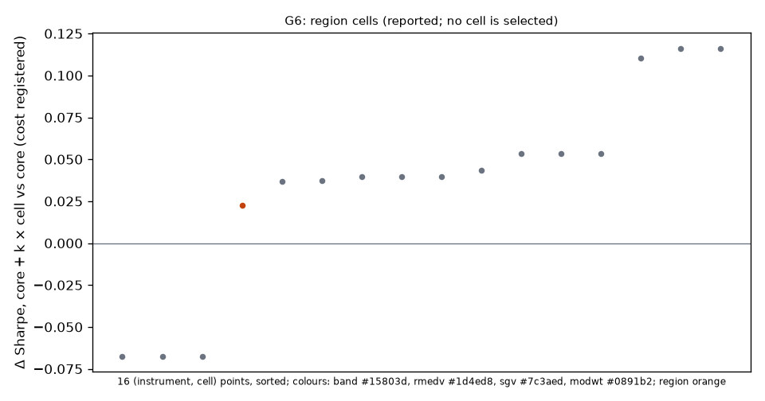
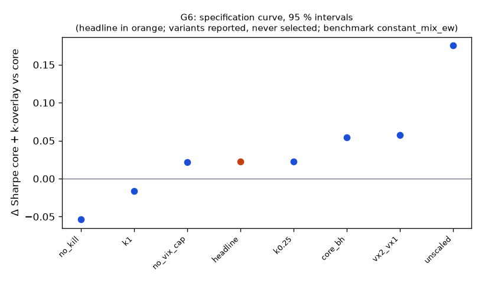

# Family G6

**Mechanism.** Implied volatility exceeds realized volatility on average and the VIX futures curve is in contango most of the time, so a short position in VIX short-term futures (long SVXY) earns the variance risk premium and the roll; it carries crash risk, which a term-structure filter (flat in backwardation), a VIX cap and hard loss rules bound. Added to a volatility-managed index core it raises the Sharpe ratio if the premium is not just the core's equity beta.

- Registered: 4d90603bd83c55b893d0f8e8617d3d44700c9a8b (2026-10-11); run at 2026-10-11T08:03:56.969618+00:00, code ec6721937cba, git 5422e7cc2350
- Instruments: SVXY (pooled, weights SVXY 1.00, equal weights); window 2016-01-04 → 2025-10-01; benchmark constant_mix_ew
- N_eff 1.00 of 1 instruments (the pooled stream's effective count)
- Test: marginal, one-sided, at cost registered; excess returns: FRED DTB3 as of each session's open, ACT/360
- MDE line: Δ Sharpe 0.38 at 80% power over 2446 days, ρ 0.926, reference Sharpe 0.70, 4 families; expected 0.17 → a DIAGNOSTIC (below its MDE)
- MDE at the realized ρ 0.960 and reference Sharpe 1.06 over 2400 days: Δ Sharpe 0.28 (reported; the registered line is the one above)
- Trials: family 8 / budget 8; program 29 / 42 trials, 4 / 5 families

## Headline test

- Sharpe(core + 0.50 × overlay) 1.08 vs core 1.06 on 2400 days: difference 0.02 (interval -0.12 … —), Ledoit–Wolf one-sided p = 0.3973; max drawdown -19.4 % vs -19.4 % (difference 0.0 %, interval -6.7 % … 2.2 %)
- Matched volatility: the core levered ×1.14 to the portfolio's 15.3 % earns 16.2 %/yr (max DD -21.9 %) vs the portfolio's 16.6 %/yr (-19.4 %); overlay–core correlation 0.279
- The overlay alone (reported, not tested): alpha vs zero 4.5 %/yr (1.81 bp/day), one-sided p 0.0496, Newey–West t 1.57, Sharpe 0.51
- Drawdown kill fired (bar of the close; flat from the next open to the end): headline 2019-09-03 09:30:00-04:00; k1 2019-09-03 09:30:00-04:00; k0.25 2019-09-03 09:30:00-04:00; core_bh 2019-09-03 09:30:00-04:00; vx2_vx1 2018-12-04 13:35:00-05:00; no_vix_cap 2019-09-24 11:35:00-04:00; unscaled 2018-04-27 10:30:00-04:00
- Looks: K = 186 configurations examined on the development window (families/looks.jsonl); Bonferroni bound p × K = 1.0000
- PSR(0) 0.939; DSR 0.101 (N = 73 program trials, V = 0.000944) — a ledger diagnostic, not part of the verdict
- Alpha 3.3 %/yr (NW t 1.14, p 0.2532), beta 0.07
- Floors: min_net_ret 0.042 vs 0.030 → ok; min_edge_to_cost 8.265 vs 2.000 → ok; max_dd_vs_core -0.194 vs -0.194 → ok
- Coherence (cells, the verdict's): 15 (instrument, cell) points, share with the headline's sign 0.800 (needs 0.667), median cell 0.04 bp/day → coherent
- Coherence (variants, reported): 7 variants, share with the headline's sign 0.71, median variant k0.25 (floors yes) → coherent
- Before Holm across families: p 0.3973, floors yes, coherent yes, positive yes (at cost registered)

## Cost curve (every variant re-priced from its cost ledger; the verdict reads one column)

| variant | registered | 0.3 | 1.0 | 2.3 |
|---|---|---|---|---|
| headline | 0.023 (p 0.397); SR 0.75, ret 6.5 %, floors yes | 0.037 (p 0.341); SR 0.80, ret 7.0 %, floors yes | 0.035 (p 0.345); SR 0.80, ret 6.9 %, floors yes | 0.033 (p 0.355); SR 0.79, ret 6.9 %, floors yes |
| no_kill | -0.054 (p 0.670); SR 0.67, ret 8.3 %, floors no | -0.027 (p 0.579); SR 0.74, ret 9.3 %, floors no | -0.031 (p 0.591); SR 0.73, ret 9.2 %, floors no | -0.037 (p 0.615); SR 0.71, ret 9.0 %, floors no |
| k1 | -0.016 (p 0.528); SR 0.75, ret 6.5 %, floors no | 0.008 (p 0.468); SR 0.80, ret 7.0 %, floors no | 0.005 (p 0.472); SR 0.80, ret 6.9 %, floors no | 0.001 (p 0.483); SR 0.79, ret 6.9 %, floors no |
| k0.25 | 0.023 (p 0.312); SR 0.75, ret 6.5 %, floors yes | 0.030 (p 0.258); SR 0.80, ret 7.0 %, floors yes | 0.030 (p 0.264); SR 0.80, ret 6.9 %, floors yes | 0.028 (p 0.271); SR 0.79, ret 6.9 %, floors yes |
| core_bh | 0.054 (p 0.189); SR 0.75, ret 6.5 %, floors yes | 0.064 (p 0.147); SR 0.80, ret 7.0 %, floors no | 0.063 (p 0.153); SR 0.80, ret 6.9 %, floors no | 0.062 (p 0.161); SR 0.79, ret 6.9 %, floors yes |
| vx2_vx1 | 0.058 (p 0.265); SR 0.86, ret 7.4 %, floors yes | 0.065 (p 0.236); SR 0.89, ret 7.6 %, floors yes | 0.065 (p 0.238); SR 0.89, ret 7.6 %, floors yes | 0.063 (p 0.242); SR 0.88, ret 7.6 %, floors yes |
| no_vix_cap | 0.022 (p 0.395); SR 0.77, ret 6.8 %, floors yes | 0.036 (p 0.337); SR 0.82, ret 7.3 %, floors yes | 0.035 (p 0.344); SR 0.81, ret 7.2 %, floors yes | 0.032 (p 0.355); SR 0.81, ret 7.1 %, floors yes |
| unscaled | 0.175 (p 0.066); SR 1.01, ret 13.8 %, floors yes | 0.193 (p 0.048); SR 1.05, ret 14.5 %, floors yes | 0.191 (p 0.049); SR 1.05, ret 14.4 %, floors yes | 0.188 (p 0.052); SR 1.04, ret 14.3 %, floors yes |

Columns: `registered` = the simulated costs (quotes half-spread + slippage per side); a number = that round-trip cost in bp on every fill; `measured` = the forward test's fill reconciliation. The headline column shows its statistic and p first.

## Account check (risk/account.py; nothing here changes a P&L)

- margin_30k (margin account, equity 30,000): tradable
- Day trades: 1 in total, at most 1 in 5 sessions; PDT rule applies: no; first flag None
- Gross exposure: 1.00× intraday (limit 4×), 1.00× overnight (limit 2×); first breach None
- What the PDT rule would cost on an account under the floor: 0.0 % of the day trades blocked (0)

## Data notes

- Headline members: 59 session(s) priced with the first as-of cost table (2016Q1), 0 bar(s) in stress sessions, 0 session(s) without a cash-yield rate

## Core families (run in this batch; no trial, no Holm)

- G2_core: registered 4208d7bf2bc47097b5f91f320fe96cad69cfffe8 (2026-10-11); QQQ, SPY (weights QQQ 0.50, SPY 0.50); benchmark constant_mix_ew
  - headline: 2 member cell(s); raw Sharpe 1.23, return 16.8 %/yr, vol 13.4 %, max DD -18.5 % (booked costs, T-bill credited)
  - benchmark: 0 member cell(s); raw Sharpe 0.91, return 17.4 %/yr, vol 20.0 %, max DD -30.9 % (booked costs, T-bill credited)

**Core + k × overlay on the registered account** (PLAN3 G2: overlay notional + core notional ≤ 2 × equity at every decision; the account check applies Reg-T 2× overnight and 4× intraday at or above the PDT floor)

| variant | core | k | max gross intraday | max gross overnight | ≤ 2× (PLAN3) | account | reasons |
|---|---|---|---|---|---|---|---|
| headline | G2_core/headline | 0.50 | 1.50 | 1.50 | yes | tradable | — |
| no_kill | G2_core/headline | 0.50 | 1.50 | 1.50 | yes | tradable | — |
| k1 | G2_core/headline | 1.00 | 2.00 | 2.00 | yes | tradable | — |
| k0.25 | G2_core/headline | 0.25 | 1.25 | 1.25 | yes | tradable | — |
| core_bh | G2_core/benchmark | 0.50 | 1.50 | 1.50 | yes | tradable | — |
| vx2_vx1 | G2_core/headline | 0.50 | 1.50 | 1.50 | yes | tradable | — |
| no_vix_cap | G2_core/headline | 0.50 | 1.50 | 1.50 | yes | tradable | — |
| unscaled | G2_core/headline | 0.50 | 1.50 | 1.50 | yes | tradable | — |

## Region cells (the specification curve over every cell; reported, the region is the headline)

*each cell run by the engine as its own rule cell (risk profile, costs, fills and cash yield of the headline) and re-priced from its cost ledger at each column; the region is the headline stream*

- 15 cells at cost registered, statistic Δ Sharpe (core + k × cell vs core): share with the headline's sign 0.800, median cell 0.040; positive 12 / 15



Every cell at cost registered (excess of the T-bill), sorted by Δ Sharpe (core + k × cell vs core):

| cell | days | alpha_bp | CI (NW 95 %) | sharpe | Δ Sharpe vs core |
|---|---|---|---|---|---|
| t1.05_vix30 | 2448 | 3.17 | 0.61 … 5.73 | 0.79 | 0.116 |
| t1.05_vix25 | 2448 | 3.09 | 0.53 … 5.64 | 0.77 | 0.116 |
| t1.05_vix20 | 2448 | 2.71 | 0.20 … 5.22 | 0.70 | 0.110 |
| t1.075_vix20 | 2448 | 1.35 | -0.66 … 3.36 | 0.44 | 0.053 |
| t1.075_vix25 | 2448 | 1.39 | -0.61 … 3.39 | 0.45 | 0.053 |
| t1.075_vix30 | 2448 | 1.39 | -0.61 … 3.39 | 0.45 | 0.053 |
| t1_vix20 | 2448 | 0.98 | -0.83 … 2.78 | 0.36 | 0.043 |
| t1.025_vix20 | 2448 | 0.96 | -0.71 … 2.63 | 0.38 | 0.040 |
| t1.025_vix25 | 2448 | 1.33 | -0.42 … 3.09 | 0.50 | 0.040 |
| t1.025_vix30 | 2448 | 1.43 | -0.35 … 3.21 | 0.53 | 0.040 |
| t1_vix30 | 2448 | 1.33 | -0.60 … 3.25 | 0.45 | 0.037 |
| t1_vix25 | 2448 | 1.22 | -0.68 … 3.12 | 0.42 | 0.037 |
| t1.1_vix20 | 2448 | -0.00 | -1.59 … 1.58 | -0.00 | -0.067 |
| t1.1_vix25 | 2448 | -0.00 | -1.59 … 1.58 | -0.00 | -0.067 |
| t1.1_vix30 | 2448 | -0.00 | -1.59 … 1.58 | -0.00 | -0.067 |

The region at each cost: alpha bp/day (excess Sharpe), Δ Sharpe vs core:

|  | registered | 0.3 | 1.0 | 2.3 |
|---|---|---|---|---|
| region (headline) | 1.81 bp (0.51), Δ 0.023 | 1.97 bp (0.56), Δ 0.037 | 1.96 bp (0.55), Δ 0.035 | 1.93 bp (0.54), Δ 0.033 |

## Episodes (headline at cost registered, day by day; reported)

### feb2018: 2018-01-22 → 2018-03-10

- 34 sessions, held at the close on 12; overlay -3.3 %, worst day -3.1 %, max drawdown in the episode -5.4 %; core -1.4 %, core + k × overlay -3.2 %

| date | position | VIX | VX1/VIX | overlay | overlay cum | core | portfolio cum |
|---|---|---|---|---|---|---|---|
| 2018-01-22 | 0.300 | 11.03 | 1.072 | 0.47 % | 0.5 % | 0.94 % | 1.2 % |
| 2018-01-23 | 0.300 | 11.10 | 1.079 | -0.55 % | -0.1 % | 0.51 % | 1.4 % |
| 2018-01-24 | 0.400 | 11.47 | 1.066 | -0.86 % | -0.9 % | -0.31 % | 0.7 % |
| 2018-01-25 | 0.300 | 11.58 | 1.073 | -0.63 % | -1.6 % | -0.01 % | 0.3 % |
| 2018-01-26 | 0.300 | 11.08 | 1.112 | 0.23 % | -1.3 % | 1.32 % | 1.8 % |
| 2018-01-29 | 0.000 | 13.84 | 0.977 | -3.11 % | -4.4 % | -0.54 % | -0.4 % |
| 2018-01-30 | 0.000 | 14.79 | 0.945 | 0.00 % | -4.4 % | -0.91 % | -1.3 % |
| 2018-01-31 | 0.000 | 13.54 | 0.995 | 0.00 % | -4.4 % | 0.22 % | -1.1 % |
| 2018-02-01 | 0.000 | 13.47 | 0.986 | 0.00 % | -4.4 % | -0.45 % | -1.5 % |
| 2018-02-02 | 0.000 | 17.31 | 0.903 | 0.00 % | -4.4 % | -2.07 % | -3.5 % |
| 2018-02-05 | 0.000 | 37.32 | 0.890 | 0.01 % | -4.4 % | -3.95 % | -7.4 % |
| 2018-02-06 | 0.000 | 29.98 | 0.796 | 0.00 % | -4.4 % | 1.57 % | -5.9 % |
| 2018-02-07 | 0.000 | 27.73 | 0.845 | 0.00 % | -4.4 % | -0.75 % | -6.6 % |
| 2018-02-08 | 0.000 | 33.46 | 0.840 | 0.00 % | -4.4 % | -3.23 % | -9.6 % |
| 2018-02-09 | 0.000 | 29.06 | 0.935 | 0.00 % | -4.4 % | 1.26 % | -8.5 % |
| 2018-02-12 | 0.000 | 25.61 | 1.008 | 0.01 % | -4.4 % | 0.95 % | -7.6 % |
| 2018-02-13 | 0.033 | 24.97 | 1.010 | 0.07 % | -4.3 % | 0.22 % | -7.4 % |
| 2018-02-14 | 0.067 | 19.26 | 1.136 | 0.68 % | -3.6 % | 1.00 % | -6.1 % |
| 2018-02-15 | 0.500 | 19.13 | 0.916 | -0.32 % | -3.9 % | 0.92 % | -5.4 % |
| 2018-02-16 | 0.000 | 19.46 | 0.913 | -0.32 % | -4.2 % | -0.10 % | -5.7 % |
| 2018-02-20 | 0.000 | 20.60 | 0.892 | 0.02 % | -4.2 % | -0.13 % | -5.8 % |
| 2018-02-21 | 0.000 | 20.02 | 0.928 | 0.00 % | -4.2 % | -0.25 % | -6.0 % |
| 2018-02-22 | 0.000 | 18.72 | 0.966 | 0.00 % | -4.2 % | 0.06 % | -6.0 % |
| 2018-02-23 | 0.000 | 16.49 | 1.017 | 0.00 % | -4.2 % | 1.09 % | -5.0 % |
| 2018-02-26 | 0.100 | 15.80 | 1.024 | 0.13 % | -4.1 % | 0.77 % | -4.2 % |
| 2018-02-27 | 0.100 | 18.59 | 0.943 | -0.92 % | -5.0 % | -0.76 % | -5.3 % |
| 2018-02-28 | 0.000 | 19.85 | 0.936 | 0.25 % | -4.7 % | -0.54 % | -5.7 % |
| 2018-03-01 | 0.000 | 22.47 | 0.889 | 0.00 % | -4.7 % | -0.86 % | -6.5 % |
| 2018-03-02 | 0.000 | 19.59 | 0.971 | 0.00 % | -4.7 % | 0.43 % | -6.1 % |
| 2018-03-05 | 0.000 | 18.73 | 0.976 | 0.01 % | -4.7 % | 0.69 % | -5.5 % |
| 2018-03-06 | 0.000 | 18.36 | 0.998 | 0.00 % | -4.7 % | 0.21 % | -5.3 % |
| 2018-03-07 | 0.000 | 17.76 | 1.006 | 0.00 % | -4.7 % | 0.07 % | -5.2 % |
| 2018-03-08 | 0.200 | 16.54 | 1.041 | 0.19 % | -4.5 % | 0.32 % | -4.9 % |
| 2018-03-09 | 0.400 | 14.64 | 1.078 | 1.25 % | -3.3 % | 1.11 % | -3.2 % |

### mar2020: 2020-02-18 → 2020-04-11

- 38 sessions, held at the close on 0; overlay 0.1 %, worst day -0.0 %, max drawdown in the episode -0.0 %; core -12.4 %, core + k × overlay -12.4 %

| date | position | VIX | VX1/VIX | overlay | overlay cum | core | portfolio cum |
|---|---|---|---|---|---|---|---|
| 2020-02-18 | 0.000 | 14.83 | 1.003 | 0.02 % | 0.0 % | -0.08 % | -0.1 % |
| 2020-02-19 | 0.000 | 14.38 | 1.009 | 0.00 % | 0.0 % | 0.72 % | 0.6 % |
| 2020-02-20 | 0.000 | 15.56 | 1.033 | 0.00 % | 0.0 % | -0.66 % | -0.0 % |
| 2020-02-21 | 0.000 | 17.08 | 0.991 | 0.00 % | 0.0 % | -1.39 % | -1.4 % |
| 2020-02-24 | 0.000 | 25.03 | 0.802 | 0.01 % | 0.0 % | -3.39 % | -4.8 % |
| 2020-02-25 | 0.000 | 27.85 | 0.798 | 0.00 % | 0.0 % | -2.00 % | -6.7 % |
| 2020-02-26 | 0.000 | 27.56 | 0.810 | 0.00 % | 0.1 % | 0.06 % | -6.6 % |
| 2020-02-27 | 0.000 | 39.16 | 0.671 | 0.00 % | 0.1 % | -3.28 % | -9.7 % |
| 2020-02-28 | 0.000 | 40.11 | 0.656 | 0.00 % | 0.1 % | -0.37 % | -10.0 % |
| 2020-03-02 | 0.000 | 33.42 | 0.786 | 0.01 % | 0.1 % | 2.60 % | -7.7 % |
| 2020-03-03 | 0.000 | 36.82 | 0.792 | 0.00 % | 0.1 % | -1.54 % | -9.1 % |
| 2020-03-04 | 0.000 | 31.99 | 0.857 | 0.00 % | 0.1 % | 2.10 % | -7.2 % |
| 2020-03-05 | 0.000 | 39.62 | 0.805 | 0.00 % | 0.1 % | -1.61 % | -8.7 % |
| 2020-03-06 | 0.000 | 41.94 | 0.853 | 0.00 % | 0.1 % | -0.74 % | -9.3 % |
| 2020-03-09 | 0.000 | 54.46 | 0.815 | 0.01 % | 0.1 % | -3.28 % | -12.3 % |
| 2020-03-10 | 0.000 | 47.30 | 0.884 | 0.00 % | 0.1 % | 2.13 % | -10.5 % |
| 2020-03-11 | 0.000 | 53.90 | 0.860 | 0.00 % | 0.1 % | -1.59 % | -11.9 % |
| 2020-03-12 | 0.000 | 75.47 | 0.772 | 0.00 % | 0.1 % | -3.07 % | -14.6 % |
| 2020-03-13 | 0.000 | 57.83 | 0.924 | 0.00 % | 0.1 % | 2.65 % | -12.3 % |
| 2020-03-16 | 0.000 | 82.69 | 0.878 | 0.00 % | 0.1 % | -3.65 % | -15.5 % |
| 2020-03-17 | 0.000 | 75.91 | 0.907 | 0.00 % | 0.1 % | 1.52 % | -14.2 % |
| 2020-03-18 | 0.000 | 76.45 | 0.912 | 0.00 % | 0.1 % | -0.87 % | -15.0 % |
| 2020-03-19 | 0.000 | 72.00 | 0.921 | 0.00 % | 0.1 % | 0.08 % | -14.9 % |
| 2020-03-20 | 0.000 | 66.04 | 0.932 | 0.00 % | 0.1 % | -0.86 % | -15.7 % |
| 2020-03-23 | 0.000 | 61.59 | 0.803 | 0.00 % | 0.1 % | -0.27 % | -15.9 % |
| 2020-03-24 | 0.000 | 61.67 | 0.782 | 0.00 % | 0.1 % | 1.67 % | -14.5 % |
| 2020-03-25 | 0.000 | 63.95 | 0.802 | 0.00 % | 0.1 % | 0.04 % | -14.4 % |
| 2020-03-26 | 0.000 | 61.00 | 0.752 | 0.00 % | 0.1 % | 1.19 % | -13.4 % |
| 2020-03-27 | 0.000 | 65.54 | 0.815 | 0.00 % | 0.1 % | -0.74 % | -14.1 % |
| 2020-03-30 | 0.000 | 57.08 | 0.872 | -0.00 % | 0.1 % | 0.75 % | -13.4 % |
| 2020-03-31 | 0.000 | 53.54 | 0.874 | -0.00 % | 0.1 % | -0.26 % | -13.6 % |
| 2020-04-01 | 0.000 | 57.06 | 0.899 | 0.00 % | 0.1 % | -0.94 % | -14.4 % |
| 2020-04-02 | 0.000 | 50.91 | 0.927 | 0.00 % | 0.1 % | 0.45 % | -14.1 % |
| 2020-04-03 | 0.000 | 46.80 | 0.960 | 0.00 % | 0.1 % | -0.30 % | -14.3 % |
| 2020-04-06 | 0.000 | 45.24 | 0.923 | 0.00 % | 0.1 % | 1.45 % | -13.1 % |
| 2020-04-07 | 0.000 | 46.70 | 0.943 | 0.00 % | 0.1 % | -0.01 % | -13.1 % |
| 2020-04-08 | 0.000 | 43.35 | 0.978 | 0.00 % | 0.1 % | 0.61 % | -12.6 % |
| 2020-04-09 | 0.000 | 41.67 | 0.991 | 0.00 % | 0.1 % | 0.19 % | -12.4 % |

### aug2024: 2024-07-22 → 2024-08-24

- 25 sessions, held at the close on 0; overlay 0.5 %, worst day 0.0 %, max drawdown in the episode 0.0 %; core 0.8 %, core + k × overlay 0.8 %

| date | position | VIX | VX1/VIX | overlay | overlay cum | core | portfolio cum |
|---|---|---|---|---|---|---|---|
| 2024-07-22 | 0.000 | 14.91 | 1.009 | 0.04 % | 0.0 % | 1.20 % | 1.2 % |
| 2024-07-23 | 0.000 | 14.72 | 1.014 | 0.01 % | 0.1 % | -0.22 % | 1.0 % |
| 2024-07-24 | 0.000 | 18.04 | 0.946 | 0.01 % | 0.1 % | -2.66 % | -1.7 % |
| 2024-07-25 | 0.000 | 18.46 | 0.929 | 0.01 % | 0.1 % | -0.61 % | -2.3 % |
| 2024-07-26 | 0.000 | 16.39 | 0.987 | 0.01 % | 0.1 % | 0.90 % | -1.4 % |
| 2024-07-29 | 0.000 | 16.60 | 0.962 | 0.04 % | 0.1 % | 0.14 % | -1.3 % |
| 2024-07-30 | 0.000 | 17.69 | 0.932 | 0.01 % | 0.2 % | -0.72 % | -2.0 % |
| 2024-07-31 | 0.000 | 16.36 | 0.978 | 0.01 % | 0.2 % | 1.79 % | -0.2 % |
| 2024-08-01 | 0.000 | 18.59 | 0.940 | 0.01 % | 0.2 % | -1.47 % | -1.7 % |
| 2024-08-02 | 0.000 | 23.39 | 0.934 | 0.01 % | 0.2 % | -1.67 % | -3.3 % |
| 2024-08-05 | 0.000 | 38.57 | 0.832 | 0.04 % | 0.2 % | -2.21 % | -5.5 % |
| 2024-08-06 | 0.000 | 27.71 | 0.930 | 0.01 % | 0.3 % | 0.67 % | -4.8 % |
| 2024-08-07 | 0.000 | 27.85 | 0.900 | 0.01 % | 0.3 % | -0.58 % | -5.4 % |
| 2024-08-08 | 0.000 | 23.79 | 0.954 | 0.01 % | 0.3 % | 1.86 % | -3.6 % |
| 2024-08-09 | 0.000 | 20.37 | 0.957 | 0.01 % | 0.3 % | 0.34 % | -3.3 % |
| 2024-08-12 | 0.000 | 20.71 | 0.940 | 0.04 % | 0.3 % | 0.13 % | -3.2 % |
| 2024-08-13 | 0.000 | 18.12 | 0.968 | 0.01 % | 0.4 % | 1.42 % | -1.8 % |
| 2024-08-14 | 0.000 | 16.19 | 1.003 | 0.01 % | 0.4 % | 0.15 % | -1.7 % |
| 2024-08-15 | 0.000 | 15.23 | 1.008 | 0.01 % | 0.4 % | 1.39 % | -0.3 % |
| 2024-08-16 | 0.000 | 14.80 | 1.032 | 0.01 % | 0.4 % | 0.12 % | -0.2 % |
| 2024-08-19 | 0.000 | 14.65 | 1.009 | 0.04 % | 0.4 % | 0.79 % | 0.6 % |
| 2024-08-20 | 0.000 | 15.88 | 1.000 | 0.01 % | 0.5 % | -0.11 % | 0.5 % |
| 2024-08-21 | 0.000 | 16.27 | 0.990 | 0.01 % | 0.5 % | 0.30 % | 0.8 % |
| 2024-08-22 | 0.000 | 17.55 | 0.969 | 0.01 % | 0.5 % | -0.77 % | 0.0 % |
| 2024-08-23 | 0.000 | 15.86 | 1.004 | 0.01 % | 0.5 % | 0.72 % | 0.8 % |

Position: the pooled fraction of equity held at the close (side × the fraction committed at entry). VIX and VX1/VIX: the day's close and settlement, read by the NEXT session's decision. Overlay: the headline's net daily return; portfolio: core + k × the overlay's excess return, as the marginal test adds it.

## Trade statistics (headline; booked costs)

| instrument | round_trips_per_day | sessions_traded | long_pnl_bp_per_day | short_pnl_bp_per_day | long / short trades |
|---|---|---|---|---|---|
| SVXY | 0.023 | 0.197 | 2.005 | 0.000 | 740 / 0 |
| pooled | 0.023 | 0.197 | 2.005 | 0.000 |  |

Round trips per day: traded notional / the session's starting equity / 2, averaged over sessions. Long / short: trading P&L by side (booked costs) per day of the member's starting cash.

## Per-instrument headline alpha (cost registered; excess of the T-bill)

| instrument | days | alpha_bp | CI (NW 95 %) | sharpe |
|---|---|---|---|---|
| SVXY | 2448 | 1.81 | -0.46 … 4.07 | 0.51 |

## Specification curve (reported; no variant is selected)



| variant | status | start | days | sharpe | statistic | CI | p | Δ on headline days | net ret | max dd | floors |
|---|---|---|---|---|---|---|---|---|---|---|---|
| headline | ok | 2016-01-06 | 2400 | 0.51 | 0.02 | -0.12 … — | 0.3973 | — | 6.5 % | -14.9 % | yes |
| no_kill | ok | 2016-01-06 | 2400 | 0.50 | -0.05 | -0.24 … — | 0.6703 | -0.05 | 8.3 % | -27.2 % | no |
| k1 | ok | 2016-01-06 | 2400 | 0.51 | -0.02 | -0.27 … — | 0.5279 | -0.02 | 6.5 % | -14.9 % | no |
| k0.25 | ok | 2016-01-06 | 2400 | 0.51 | 0.02 | -0.05 … — | 0.3119 | 0.02 | 6.5 % | -14.9 % | yes |
| core_bh | ok | 2016-01-06 | 2448 | 0.51 | 0.05 | -0.05 … — | 0.1886 | 0.05 | 6.5 % | -14.9 % | yes |
| vx2_vx1 | ok | 2016-02-19 | 2400 | 0.61 | 0.06 | -0.09 … — | 0.2647 | 0.06 | 7.4 % | -14.8 % | yes |
| no_vix_cap | ok | 2016-01-06 | 2400 | 0.53 | 0.02 | -0.12 … — | 0.3947 | 0.02 | 6.8 % | -14.8 % | yes |
| unscaled | ok | 2016-01-06 | 2400 | 0.85 | 0.18 | -0.01 … — | 0.0656 | 0.18 | 13.8 % | -14.4 % | yes |

`statistic` is the headline test's (Δ Sharpe vs the benchmark, the alpha, or the Δ Sharpe vs the core / reference). Coherence reads each variant's statistic on the days it shares with the headline (column 'Δ on headline days'); the curve and the p-values are each variant's own sample.

## Responses

| variant | crisis_return | exposure | max_dd | ret_ann | sharpe | skew | vol_ann | worst_day |
|---|---|---|---|---|---|---|---|---|
| headline | 2020-02-19..2020-03-24: -0.0 %; 2022-01-03..2022-10-13: -0.0 % | 0.325 | -0.178 | 0.042 | 0.509 | -1.486 | 0.089 | -0.036 |
| no_kill | 2020-02-19..2020-03-24: -2.8 %; 2022-01-03..2022-10-13: -8.9 % | 0.820 | -0.311 | 0.060 | 0.505 | -1.149 | 0.134 | -0.037 |
| k1 | 2020-02-19..2020-03-24: -0.0 %; 2022-01-03..2022-10-13: -0.0 % | 0.325 | -0.178 | 0.042 | 0.509 | -1.486 | 0.089 | -0.036 |
| k0.25 | 2020-02-19..2020-03-24: -0.0 %; 2022-01-03..2022-10-13: -0.0 % | 0.325 | -0.178 | 0.042 | 0.509 | -1.486 | 0.089 | -0.036 |
| core_bh | 2020-02-19..2020-03-24: -0.0 %; 2022-01-03..2022-10-13: -0.0 % | 0.325 | -0.178 | 0.042 | 0.509 | -1.486 | 0.089 | -0.036 |
| vx2_vx1 | 2020-02-19..2020-03-24: -0.0 %; 2022-01-03..2022-10-13: -0.0 % | 0.245 | -0.162 | 0.051 | 0.608 | -1.466 | 0.087 | -0.049 |
| no_vix_cap | 2020-02-19..2020-03-24: -0.0 %; 2022-01-03..2022-10-13: -0.0 % | 0.331 | -0.178 | 0.045 | 0.530 | -1.469 | 0.091 | -0.036 |
| unscaled | 2020-02-19..2020-03-24: -0.0 %; 2022-01-03..2022-10-13: -0.0 % | 0.212 | -0.148 | 0.114 | 0.851 | 0.334 | 0.138 | -0.052 |

Responses, splits and slices below: excess of the T-bill, at cost registered; mean_per_trade_bp and hit_rate are per position (a chain of rolled legs, ended at a side flip: Σ cash pnl / its largest leg notional) from the booked-cost trades.

## State splits (headline; reported with 95 % Newey–West intervals, not tested)

**vix_tercile**

| group | n_days | mean_bp | ci_bp | sharpe |
|---|---|---|---|---|
| high | 816 | 0.49 | -0.69 … 1.67 | 0.51 |
| low | 815 | 3.49 | -2.26 … 9.24 | 0.64 |
| mid | 817 | 1.44 | -1.76 … 4.65 | 0.53 |

**year**

| group | n_days | mean_bp | ci_bp | sharpe |
|---|---|---|---|---|
| 2016 | 250 | 11.03 | -1.49 … 23.55 | 1.69 |
| 2017 | 251 | 12.93 | -0.32 … 26.18 | 2.06 |
| 2018 | 251 | -4.33 | -13.29 … 4.62 | -0.95 |
| 2019 | 252 | -1.96 | -9.84 … 5.91 | -0.45 |
| 2020 | 253 | 0.00 | -0.00 … 0.00 | 1.17 |
| 2021 | 252 | 0.00 | -0.00 … 0.00 | 0.22 |
| 2022 | 251 | 0.00 | -0.00 … 0.00 | 0.65 |
| 2023 | 250 | -0.00 | -0.00 … 0.00 | -0.41 |
| 2024 | 252 | 0.00 | -0.00 … 0.00 | 0.01 |
| 2025 | 186 | -0.00 | -0.00 … -0.00 | -2.07 |

**macro_day**

| group | n_days | mean_bp | ci_bp | sharpe |
|---|---|---|---|---|
| macro | 301 | 6.45 | 0.92 … 11.99 | 2.18 |
| other | 2147 | 1.15 | -1.24 … 3.55 | 0.32 |

## Sample splits (headline; reported)

| split | n_days | sharpe | bench_sharpe | ret | max_dd | mean_bp |
|---|---|---|---|---|---|---|
| 2016_2019 | 1004 | 0.80 | 0.40 | 49.6 % | -17.8 % | 4.40 |
| 2020_2025 | 1444 | 0.03 | 0.33 | -0.0 % | -0.0 % | 0.00 |
| post_break | 1908 | -0.28 | 0.38 | -12.0 % | -16.2 % | -0.61 |

## Quasi-holdout slice (reported; never a gate)

*quasi-holdout 2025-10-01 → 2026-09-30: contaminated (the U11 holdout exposed these days' buy-and-hold outcomes before the families were chosen); a robustness slice, never a gate*

| slice | n_days | sharpe | bench_sharpe | ret | max_dd | mean_bp |
|---|---|---|---|---|---|---|
| 2025-10 → 2026-09 | 250 | 26.22 | 0.93 | 3.8 % | 0.0 % | 1.49 |

## Per-instrument headline Sharpe (raw and James–Stein shrunk toward the family mean)

| instrument | sharpe | sharpe_js |
|---|---|---|
| SVXY | 0.51 | 0.51 |

## Registered vs run spec

```
+registered: {sha: '4d90603bd83c55b893d0f8e8617d3d44700c9a8b', date: '2026-10-11'}
```
